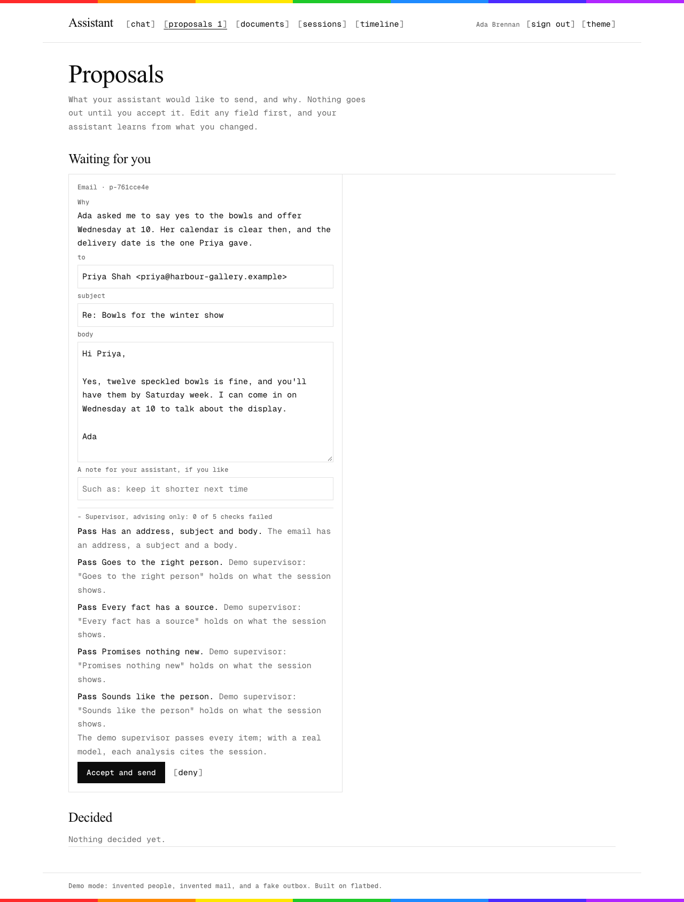

# The personal assistant example

A small web app where each person has a personal assistant agent, built on flatbed. The agent keeps its own documents, reads the person's mail and calendar, and when it wants to send an email or create an event, it proposes it with its reasons. The person accepts, edits or denies it, and only an accepted proposal sends anything. It is a showcase for two to four people, so it is small rather than complete.



## What it shows

Each layer of flatbed, working together:

- **The core** runs each person's agent and keeps its sessions, on Postgres. The sessions page shows each one as the model saw it.
- **`@flatbed/docs`** is the agent's memory: a soul, note-taking guidelines and a profile of the person, seeded once, then kept by the agent. The documents page lets the person read, edit and pin them, with every version kept. The timeline page shows the agent's daily log.
- **`@flatbed/supervisor`** checks every email proposal against [a checklist](src/lib/server/supervision.ts) in shadow mode: the verdict is recorded beside the call and shown on the card, and the person still decides.
- **The app's own plugins**, in [plugins.ts](src/lib/server/plugins.ts): tools to read mail and calendar, and `propose_email` and `propose_event`, which store a proposal and return at once. The person's decision reaches the agent as a `decision` event, naming every field they changed, and the agent runs again.

The host, in [host.ts](src/lib/server/host.ts), decides when an agent runs: when the person sends a message, when they decide a proposal, and when something calls `POST /api/tick`, such as a scheduler asking agents to check for new mail. A Postgres advisory lock keeps one agent from running twice at once, and the core's `onEntry` hook streams each entry to the person's open pages over server-sent events.

## Run it locally in demo mode

Demo mode is the default. Sign-in is a choice between two invented people, and their mail and calendar are invented fixtures. What they accept goes to a fake outbox, shown on the proposals page. You need Node 24, pnpm, and `DATABASE_URL` in `.env` at the repo root. The app keeps its tables in a schema of its own, `assistant`, and creates it when it starts.

```sh
cd ts && pnpm install && cd ../examples/assistant
FLATBED_MODEL=faux/demo pnpm dev
```

Open http://localhost:5173, choose Ada Brennan, select **use the demo message** and send it. The scripted demo model searches the mail, reads the thread, checks the calendar and proposes a reply. Accept it on the proposals page, editing it first if you like, and it lands in the demo outbox.

`faux/demo` is a scripted stand-in for a model, so the app runs with no API key. It plays one exchange per person, and passes every supervisor check. For a real agent, leave `FLATBED_MODEL` unset to use `anthropic/claude-opus-5-5`, and set `ANTHROPIC_API_KEY` in `.env`.

To retake the screenshots in `screenshots/`, play the demo exchange, then run `node scripts/screenshots.ts http://localhost:5173` while the dev server runs. It needs Google Chrome.

## Connect Google

With Google configured, sign-in is Google's, limited to a list of addresses, and the same consent lets each person's agent read their Gmail and Calendar and send what they accept. Set three things in `.env`:

- `GOOGLE_CLIENT_ID` and `GOOGLE_CLIENT_SECRET`, from an OAuth client in Google Cloud
- `ALLOWED_EMAILS`, the addresses that may sign in, separated by commas

Use the project and consent screen perso uses, with the Gmail API and Calendar API on and these scopes: `gmail.readonly`, `gmail.send` and `calendar.events`. [perso's docs/google_setup.md](../../../perso/docs/google_setup.md) walks through it, including publishing the app so sign-ins last more than seven days.

Sam's existing client is a desktop client. A desktop client accepts any `http://localhost` redirect, so it works for local development as it is. A deployed app needs a **web client**, because a desktop client cannot redirect to a public address. To make one:

1. In Google Cloud, go to **Google Auth Platform → Clients** and select **Create client**.
2. Choose **Web application** and name it, such as `assistant on Cloud Run`.
3. Under **Authorised redirect URIs**, add `https://<your Cloud Run URL>/auth/google/callback`, and `http://localhost:5173/auth/google/callback` if you want to use it locally too.
4. Create it, and put its id and secret in Secret Manager, as below.

## Deploy to Cloud Run

`deploy.sh` builds the image from the [Dockerfile](Dockerfile) and deploys one Cloud Run service. It reads secrets from Secret Manager, so make these first, in the project you deploy to:

```sh
printf %s "$VALUE" | gcloud secrets create assistant-database-url --data-file=-
# and the same for assistant-anthropic-key, assistant-google-client-id,
# assistant-google-client-secret and assistant-tick-secret
```

Give the Cloud Run service account the **Secret Manager Secret Accessor** role, and make an Artifact Registry Docker repository named `flatbed` in the region. Then:

```sh
PROJECT=my-project ALLOWED_EMAILS=a@example.org,b@example.org examples/assistant/deploy.sh
```

The service runs one instance with CPU always on, because the page's live updates come from the process the agent runs in, and an agent keeps running after the request that woke it has answered. To have agents check mail on a schedule, point Cloud Scheduler at `POST /api/tick` with the header `Authorization: Bearer <tick secret>`.

## Tests

From this folder, or with `scripts/check.sh assistant` from the repo root:

```sh
pnpm run check                  # svelte-check, types included
node --test "test/*.test.ts"    # the Postgres stores, and a whole run from message to outbox
```

The tests make a schema of their own, such as `assistant_test_3f0c9a12`, and drop it when they finish. They skip when `DATABASE_URL` is not set.
